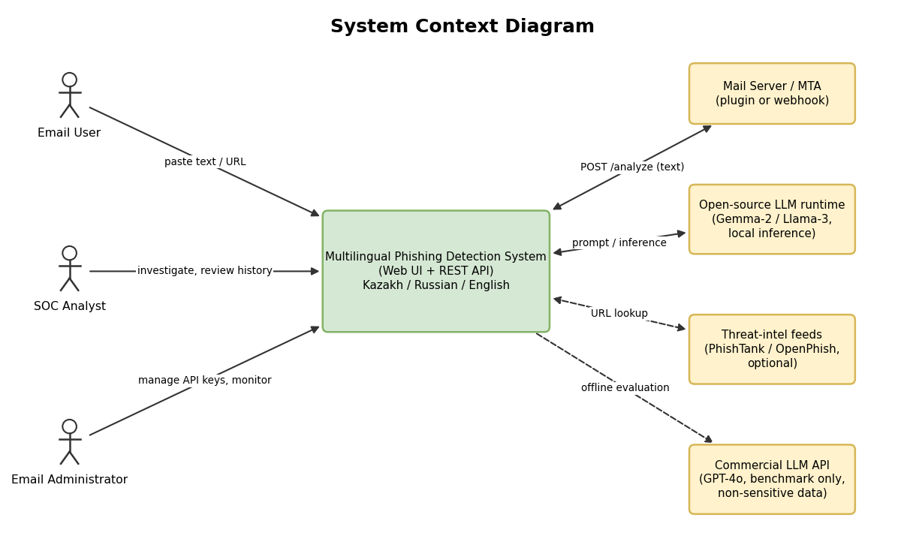
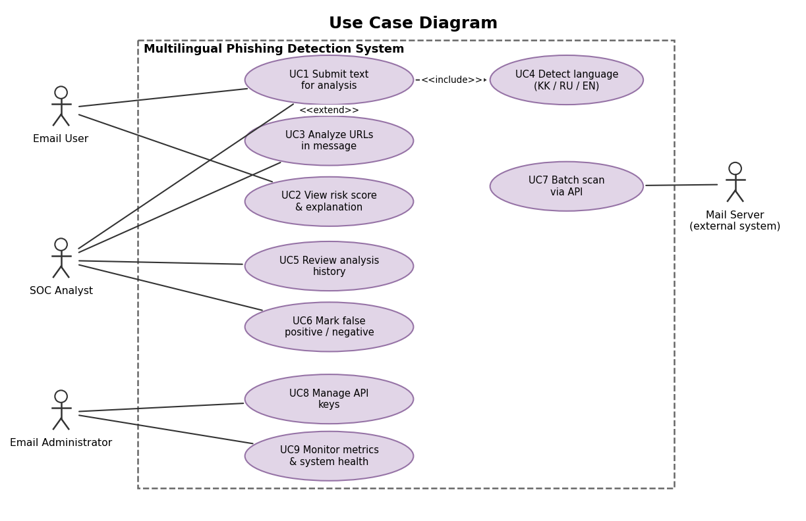
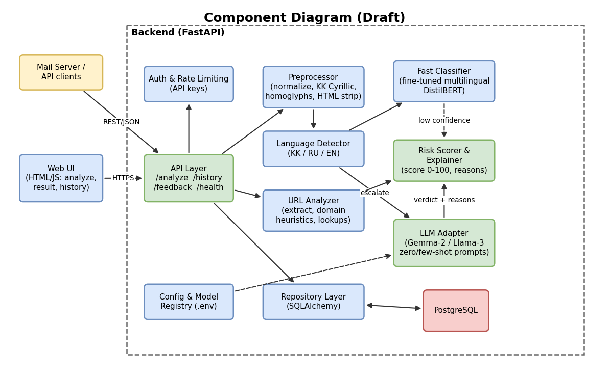
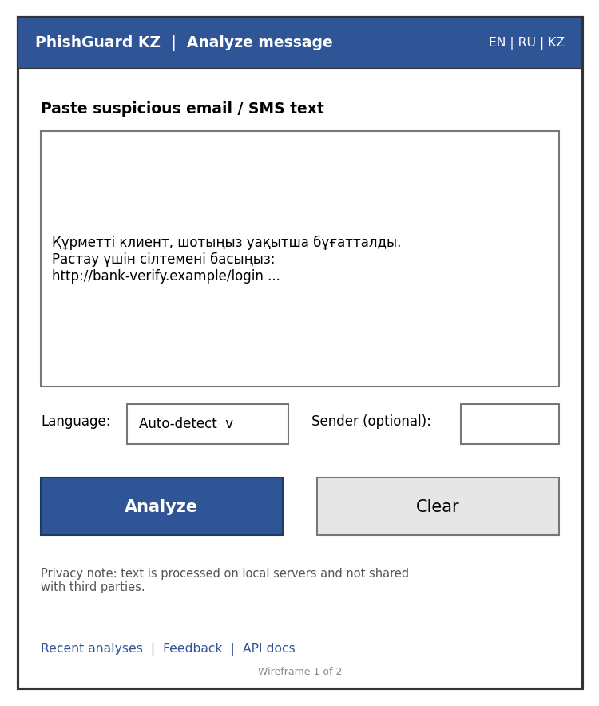
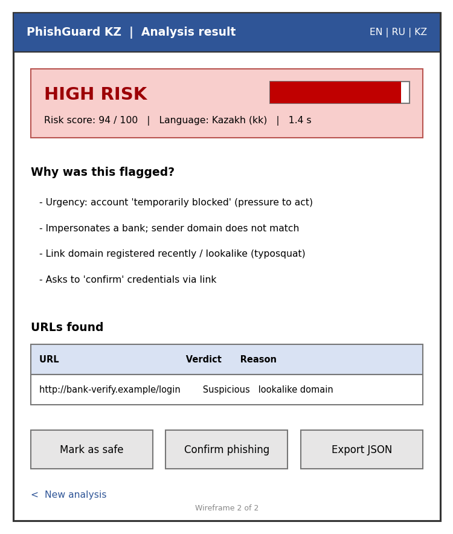

**PRE-DEFENSE 1 — PROJECT DOCUMENTATION**

**Multilingual Phishing Detection System for Kazakh, Russian and English Using Large Language Models**

Mandatory Project Components 1–8

| **Item**                   | **Details**                                                                        |
|----------------------------|------------------------------------------------------------------------------------|
| **Developer**              | Imanbayev Islam (sole developer)                                                   |
| **Supervisor**             | \[Supervisor full name and title\]                       |
| **University / Programme** | \[University, faculty, programme\]                       |
| **Repository**             | multilingual-phishing-detection-llm (\[repository URL\]) |
| **Version / date**         | v0.1 — October 2026                                                                |
| **Release tag**            | pre-defense-1 (to be created before submission)                                    |

*Text highlighted in \[yellow\] is a placeholder that only you can fill in (names, interview data, supervisor feedback). Everything else is a draft proposal for you to review and adjust.*

**Table of Contents**

[1. Project Proposal 3](#project-proposal)

[1.1 Project titles 3](#project-titles)

[1.2 Developer and supervisor 3](#developer-and-supervisor)

[1.3 Problem statement 3](#problem-statement)

[1.4 Target users 3](#target-users)

[1.5 Project aim 4](#project-aim)

[1.6 Objectives 4](#objectives)

[1.7 Expected outcomes 4](#expected-outcomes)

[1.8 Scope boundaries 4](#scope-boundaries)

[2. Evidence of Relevance 6](#evidence-of-relevance)

[2.1 Interview / discussion log 6](#interview-discussion-log)

[2.2 Interview guide (suggested questions) 6](#interview-guide-suggested-questions)

[2.3 Evidence that Kazakh-language phishing evades traditional filters 6](#evidence-that-kazakh-language-phishing-evades-traditional-filters)

[2.3.1 Ethics and data handling 7](#ethics-and-data-handling)

[3. Literature Review 8](#literature-review)

[3.1 Review method 8](#review-method)

[3.2 From rules to transformers in phishing detection 8](#from-rules-to-transformers-in-phishing-detection)

[3.3 Transformer models: BERT, RoBERTa, DistilBERT and multilingual variants 8](#transformer-models-bert-roberta-distilbert-and-multilingual-variants)

[3.4 Large language models and zero-shot detection 8](#large-language-models-and-zero-shot-detection)

[3.5 NLP challenges in low-resource languages (Kazakh) 8](#nlp-challenges-in-low-resource-languages-kazakh)

[3.6 Structured publication analysis 9](#structured-publication-analysis)

[3.7 Synthesis and research gap 10](#synthesis-and-research-gap)

[4. Existing System Comparison 11](#existing-system-comparison)

[Summary 11](#summary)

[5. Technology Comparison 12](#technology-comparison)

[5.1 Decision 1: LLM inference engine 12](#decision-1-llm-inference-engine)

[5.2 Decision 2: Backend framework 12](#decision-2-backend-framework)

[5.3 Decision 3: Database 13](#decision-3-database)

[6. Requirements Specification 14](#requirements-specification)

[6.1 Functional requirements 14](#functional-requirements)

[6.2 Non-functional requirements 14](#non-functional-requirements)

[7. Architecture and Diagrams 16](#architecture-and-diagrams)

[7.1 Architectural description 16](#architectural-description)

[7.2 System Context Diagram 16](#system-context-diagram)

[7.3 Use Case Diagram 17](#use-case-diagram)

[7.4 Component Diagram (Draft) 18](#component-diagram-draft)

[7.5 Request flow 18](#request-flow)

[7.6 Preliminary data model 18](#preliminary-data-model)

[7.7 Architecture deliverable files 18](#architecture-deliverable-files)

[8. UX / Prototype Materials 20](#ux-prototype-materials)

[8.1 Key user scenarios 20](#key-user-scenarios)

[8.2 Wireframes 20](#wireframes)

[8.3 API contract: sample request and response 21](#api-contract-sample-request-and-response)

[References 23](#references)

[Appendix A. Items only you can complete 25](#appendix-a.-items-only-you-can-complete)

*If the table is empty or outdated: right-click it in Word and choose “Update Field”.*

# 1. Project Proposal

## 1.1 Project titles

| **Language** | **Title**                                                                                                                     |
|--------------|-------------------------------------------------------------------------------------------------------------------------------|
| **English**  | Multilingual Phishing Detection System for Kazakh, Russian and English Using Large Language Models                            |
| **Russian**  | Система обнаружения многоязычного фишинга на казахском, русском и английском языках с использованием больших языковых моделей |
| **Kazakh**   | Үлкен тілдік модельдерді қолдану арқылы қазақ, орыс және ағылшын тілдеріндегі көптілді фишингті анықтау жүйесі                |

\[Ask a native Kazakh speaker or your supervisor to confirm the Kazakh title wording before submission.\]

## 1.2 Developer and supervisor

| **Role**              | **Name**                                                                            |
|-----------------------|-------------------------------------------------------------------------------------|
| **Developer (sole)**  | Imanbayev Islam                                                                     |
| **Supervisor**        | \[Supervisor full name, position, e-mail\]                |
| **Committee members** | \[Names — to be granted repository access in Git Step 2\] |

## 1.3 Problem statement

Phishing remains one of the most common initial-access techniques in cyber-attacks, and the Anti-Phishing Working Group continues to document large and persistent volumes of phishing campaigns worldwide \[26\]. Conventional e-mail and SMS filters rely on blacklists, hand-written rules, or classical machine-learning models trained on keyword statistics. These approaches work best for the languages and campaigns they were built and tuned for, which are predominantly English.

Kazakhstan is a bilingual society in which Kazakh and Russian are used side by side, and English is common in business and IT. Phishing messages in this environment are frequently written in Kazakh, in Russian, or in a mixture of both (code-switching), often impersonating local banks, payment services, government portals and delivery companies. Kazakh is a low-resource language in NLP: it has far fewer labelled datasets and dedicated models than English or Russian \[14, 15, 16, 17\]. As a result, rule- and keyword-based filters have limited coverage of Kazakh vocabulary, morphology and phrasing, and attackers can further evade them with transliteration, look-alike characters and polite, context-rich wording.

In addition, large language models make it cheap for attackers to produce fluent, personalised phishing text in any language \[8, 10\]. The same class of models, however, can understand context and intent rather than only surface keywords, and has shown promising zero-shot phishing detection ability \[9, 8\]. **The problem addressed by this project is the inability of standard spam filters to reliably catch context-rich, multilingual phishing messages written in Kazakh, Russian and English.**

## 1.4 Target users

| **User group**             | **Needs**                                                                                             | **How they use the system**                                                           |
|----------------------------|-------------------------------------------------------------------------------------------------------|---------------------------------------------------------------------------------------|
| SOC analysts               | Fast triage of suspicious messages, explanation of why a message is risky, history for investigations | Web UI and API; reviews risk score, reasons and extracted URLs; marks false positives |
| E-mail / IT administrators | Integration with existing mail infrastructure, control over data, monitoring and API keys             | REST API integration (webhook or plugin), key management, metrics                     |
| General users              | Simple yes/no style guidance in their own language, no technical jargon                               | Paste a message in the web UI and read a plain-language verdict                       |

## 1.5 Project aim

To design, implement and evaluate a web-based and API-accessible system that detects phishing messages written in Kazakh, Russian and English using large language models and transformer-based classifiers, outputs an explainable risk score, and measurably outperforms a conventional baseline classifier (Naive Bayes / TF-IDF) on a multilingual test set.

## 1.6 Objectives

> **O1.** Review the literature on transformer models, LLM-based phishing detection and low-resource NLP, and compare existing systems and technologies (documentation phase).
>
> **O2.** Collect, clean and label a multilingual (KK/RU/EN) dataset of phishing and legitimate messages from public corpora, synthetic generation and consented samples, with documented provenance.
>
> **O3.** Implement a preprocessing pipeline (normalisation, language detection, URL extraction, handling of transliteration and homoglyphs).
>
> **O4.** Implement and compare three detection approaches: a Naive Bayes baseline, a fine-tuned multilingual DistilBERT classifier, and prompt-based zero/few-shot detection with an open-source LLM (Gemma-2 / Llama-3); use GPT-4o only as an offline upper-bound reference.
>
> **O5.** Build a FastAPI backend that returns a risk score (0–100), a label and human-readable reasons, with API-key authentication and persistent history in PostgreSQL.
>
> **O6.** Build a minimal web interface for the key user scenarios.
>
> **O7.** Evaluate the system with Precision, Recall, F1 and False Positive Rate per language, and report latency; document results and limitations.

## 1.7 Expected outcomes

- A working prototype (API + web UI) that classifies Kazakh, Russian and English messages.

<!-- -->

- A labelled multilingual evaluation dataset with documented sources and a datasheet.

- Quantitative comparison of baseline, fine-tuned transformer and LLM-based approaches (target: F1 above 92% overall; latency under 3 s per message).

- Project documentation, architecture diagrams, tests and a reproducible repository.

## 1.8 Scope boundaries

| **In scope**                                                                                   | **Out of scope**                                                         |
|------------------------------------------------------------------------------------------------|--------------------------------------------------------------------------|
| Text-based detection of phishing in e-mail bodies/subjects and SMS-like messages in KK, RU, EN | Image-, QR-code- and attachment-based phishing; voice phishing (vishing) |
| URL extraction and heuristic/lexical URL analysis; optional lookup in public blacklists        | Full website crawling, rendering or screenshot analysis                  |
| REST API, minimal web UI, history and feedback storage                                         | Production-grade mail gateway, SMTP/MTA deployment, enterprise SSO       |
| Evaluation on a curated test set; comparison with a baseline                                   | Real-time training on live customer mail; large-scale model pre-training |
| Prompt-based and fine-tuned (LoRA/DistilBERT) approaches                                       | Training a Kazakh LLM from scratch                                       |

#  2. Evidence of Relevance

This section documents the evidence that the problem is real for local users. The requirement is **3–5 interviews or discussions** with potential users (or a client agreement) and **verified evidence** that localised or Kazakh-language phishing evades traditional filters. Interview data and measured results can only come from you, so this section provides the plan, templates and a pre-filled structure; yellow cells must be completed with real data.

## 2.1 Interview / discussion log

Target 3–5 participants such as local IT administrators, SOC or information-security staff, university IT department staff, and ordinary e-mail users. Keep names anonymised if participants prefer (e.g. “IT admin, regional bank”).

| **ID**         | **Participant role / organisation type**                        | **Date & format**                                    | **Key findings (their words, summarised)** | **Impact on requirements**                 |
|----------------|-----------------------------------------------------------------|------------------------------------------------------|--------------------------------------------|--------------------------------------------|
| I-1            | \[e.g. IT administrator, university\] | \[date, in person/online\] | \[...\]          | \[FR-x / NFR-x\] |
| I-2            | \[e.g. SOC analyst\]                  | \[...\]                    | \[...\]          | \[...\]          |
| I-3            | \[e.g. cybersecurity professional\]   | \[...\]                    | \[...\]          | \[...\]          |
| I-4 (optional) | \[...\]                               | \[...\]                    | \[...\]          | \[...\]          |
| I-5 (optional) | \[...\]                               | \[...\]                    | \[...\]          | \[...\]          |

## 2.2 Interview guide (suggested questions)

1.  Which e-mail/messaging platforms does your organisation use, and which spam/phishing filters are in place?

<!-- -->

1.  In which languages do phishing messages reach you or your users (Kazakh, Russian, English, mixed)?

2.  Can you describe a recent phishing message that passed your filter? What made it convincing?

3.  How do you currently triage suspicious messages, and how long does it take?

4.  What would you need to trust an automatic verdict (explanations, scores, confidence)?

5.  What are your constraints on data privacy: can message text be sent to a third-party cloud API?

6.  What response time is acceptable for a verdict (seconds)? What false-positive rate is tolerable?

7.  Would you integrate such a tool via API, a plugin, or a stand-alone web page?

## 2.3 Evidence that Kazakh-language phishing evades traditional filters

Literature gives the background: low-resource status of Kazakh \[14, 15, 17\] and the fluency of LLM-generated phishing \[8\]. The project still needs **its own verified evidence**. Proposed procedure:

1.  Collect at least 30 real phishing/smishing samples in Kazakh and Russian (from your own mailbox, participants with consent, or public reports); anonymise personal data.

<!-- -->

1.  Run each sample through available baseline filters (e.g. default Apache SpamAssassin rules \[27\], a Naive Bayes TF-IDF model trained on English data) and record whether it is detected.

2.  Compare detection rates for English vs Russian vs Kazakh samples of similar attack types.

3.  Record results in the table below and cite them in the final report. Do not claim a detection-rate gap until you have measured it.

| **Sample ID** | **Language**                     | **Attack type**                                  | **Source (anonymised)**              | **Rule-based result**                      | **ML baseline result**                     | **Notes**                         |
|---------------|----------------------------------|--------------------------------------------------|--------------------------------------|--------------------------------------------|--------------------------------------------|-----------------------------------|
| S-001         | \[kk\] | \[bank impersonation\] | \[source\] | \[pass/blocked\] | \[pass/blocked\] | \[...\] |
| S-002         | \[ru\] | \[delivery scam\]      | \[source\] | \[...\]          | \[...\]          | \[...\] |
| S-003         | \[en\] | \[...\]                | \[...\]    | \[...\]          | \[...\]          | \[...\] |

Hypothesis to test (not yet a finding): filters tuned mainly for English will miss a larger share of Kazakh and code-switched messages than of English messages.

## 2.3.1 Ethics and data handling

Participants give informal consent; personal data and real organisation names are removed; raw e-mail samples are never committed to the public repository (only anonymised or synthetic samples under data/ with a datasheet).

# 3. Literature Review

## 3.1 Review method

Sources were searched in IEEE Xplore, ACM Digital Library, ACL Anthology, arXiv and Google Scholar using combinations of the keywords: phishing detection, e-mail, transformer, BERT, RoBERTa, large language model, zero-shot, multilingual, low-resource, Kazakh, Russian. Inclusion criteria: peer-reviewed or widely cited preprints; direct relevance to phishing/spam text detection, multilingual transformers, LLM prompting, or low-resource NLP; preference for publications from 2021–2026. The reference list contains 25 scientific publications (of which 13 were published in 2021 or later) and 5 technical/web sources; the requirement is at least 12 used sources including 8 scientific ones, with the majority from the last five years.

## 3.2 From rules to transformers in phishing detection

Early anti-phishing filters used blacklists and hand-written rules; later work applied classical machine-learning (Naive Bayes, SVM, Random Forest \[24, 25\]) over bag-of-words/TF-IDF and URL features \[21\]. A systematic review of NLP-based phishing e-mail detection \[7\] shows that the field moved from handcrafted features towards deep learning and, more recently, transformer-based representations. Classical models are fast and easy to deploy but see only surface features, and they must be retrained for each language and campaign style.

## 3.3 Transformer models: BERT, RoBERTa, DistilBERT and multilingual variants

The Transformer architecture \[22\] underpins BERT \[1\], which learns bidirectional context through masked-language-model pre-training and is fine-tuned for classification. RoBERTa \[2\] showed that BERT was under-trained and improved results with a better pre-training recipe. DistilBERT \[3\] compresses BERT by knowledge distillation, retaining most of its language-understanding performance while being substantially smaller and faster — attractive for the project’s latency target. Multilingual BERT transfers across languages \[5\] and XLM-R was trained on 100 languages including Kazakh and Russian \[4\], while monolingual Russian models such as RuBERT exist \[6\]. The Hugging Face Transformers library provides all these models through a common API \[23\]. Note that English-only DistilBERT checkpoints cannot be used for Kazakh; a multilingual checkpoint is required.

## 3.4 Large language models and zero-shot detection

Large language models can solve new tasks from instructions alone (zero-shot) or a few examples, and reasoning-style prompting can improve results \[11, 12\]. For phishing, Heiding et al. \[8\] compare LLM-generated and human-designed phishing and also evaluate LLMs as detectors; Koide et al. \[9\] propose ChatSpamDetector, which uses an LLM to classify phishing e-mails and to explain its decision; Roy et al. \[10\] show that popular chatbots can be misused to create convincing phishing and discuss detection countermeasures. Open-weight models such as Llama 3 \[18\] and Gemma 2 \[19\] make self-hosted, privacy-preserving inference possible, while commercial models such as GPT-4o \[20\] serve as strong but external reference points. Parameter-efficient fine-tuning such as LoRA \[13\] allows adapting an open model to the task with limited hardware.

## 3.5 NLP challenges in low-resource languages (Kazakh)

Joshi et al. \[14\] show a very unequal distribution of NLP resources across the world’s languages, and Hedderich et al. \[15\] survey techniques for low-resource settings (transfer learning, data augmentation, weak supervision). For Kazakh specifically, KazNERD \[16\] contributed a named-entity dataset, and KazMMLU \[17\] reports that even strong multilingual models (including Llama 3.1 and GPT-4) leave substantial room for improvement in Kazakh and Russian. Consequences for this project: (1) zero-shot LLM performance in Kazakh cannot be assumed and must be measured; (2) a Kazakh evaluation set must be built or collected; (3) cross-lingual transfer and data augmentation (e.g. translation of English phishing samples, template generation) are likely needed; (4) agglutinative morphology, Cyrillic/Latin transliteration and Kazakh–Russian code-switching must be handled in preprocessing.

## 3.6 Structured publication analysis

The analysis below records, for each source, the method and the finding that matters for this project. **Before submission, read each paper (at least abstract, method and results) and correct any cell so that it reflects what you have actually read.**

| **\#** | **Source**                     | **Method / model**                          | **Data / domain**               | **Key finding (to verify)**                                              | **Relevance to project**          |
|--------|--------------------------------|---------------------------------------------|---------------------------------|--------------------------------------------------------------------------|-----------------------------------|
| 1      | Devlin et al., 2019 \[1\]      | BERT, masked-LM pre-training + fine-tuning  | General NLP (English)           | Bidirectional pre-training gives strong transfer to classification tasks | Basis of transformer classifier   |
| 2      | Liu et al., 2019 \[2\]         | RoBERTa, improved pre-training              | General NLP (English)           | BERT was under-trained; better recipe improves results                   | Candidate encoder                 |
| 3      | Sanh et al., 2019 \[3\]        | Knowledge distillation (DistilBERT)         | General NLP (English)           | Smaller, faster model retaining most BERT accuracy                       | Fast first-stage classifier       |
| 4      | Conneau et al., 2020 \[4\]     | XLM-R multilingual pre-training             | 100 languages incl. kk, ru      | Strong cross-lingual transfer incl. lower-resource languages             | Multilingual encoder option       |
| 5      | Pires et al., 2019 \[5\]       | Analysis of multilingual BERT               | Multiple languages              | mBERT transfers across languages, with limits                            | Justifies multilingual checkpoint |
| 6      | Kuratov & Arkhipov, 2019 \[6\] | RuBERT adaptation                           | Russian                         | Adapted BERT for Russian tasks                                           | Russian-language option           |
| 7      | Salloum et al., 2022 \[7\]     | Systematic literature review                | Phishing e-mail detection (NLP) | Maps NLP techniques and datasets used for phishing e-mail detection      | Field overview, datasets          |
| 8      | Sahingoz et al., 2019 \[21\]   | ML classifiers on URL features              | URL phishing detection          | Lexical URL features with Random Forest give good detection              | URL analyzer design               |
| 9      | Heiding et al., 2023 \[8\]     | LLM generation & detection of phishing      | English                         | LLMs create convincing phishing and can also detect it                   | Motivation, LLM detector          |
| 10     | Koide et al., 2024 \[9\]       | ChatSpamDetector (LLM-based)                | Phishing e-mails                | LLM classifies phishing and provides explanations                        | Closest related work              |
| 11     | Roy et al., 2023 \[10\]        | Study of LLM-generated phishing + detectors | English                         | Chatbots can be misused for phishing at scale; detection discussed       | Threat model                      |
| 12     | Kojima et al., 2022 \[11\]     | Zero-shot prompting                         | General reasoning               | LLMs reason zero-shot with simple prompts                                | Prompt design                     |
| 13     | Wei et al., 2022 \[12\]        | Chain-of-thought prompting                  | General reasoning               | Intermediate reasoning improves LLM outputs                              | Explanations / reasons output     |
| 14     | Hu et al., 2022 \[13\]         | LoRA fine-tuning                            | General                         | Low-rank adapters allow cheap fine-tuning of large models                | Optional LLM adaptation           |
| 15     | Joshi et al., 2020 \[14\]      | Linguistic diversity survey                 | World languages                 | Large disparity in NLP resources across languages                        | Kazakh = low-resource             |
| 16     | Hedderich et al., 2021 \[15\]  | Survey of low-resource NLP                  | Low-resource languages          | Transfer, augmentation, weak supervision are key approaches              | Mitigation of data scarcity       |
| 17     | Yeshpanov et al., 2022 \[16\]  | Dataset paper (KazNERD)                     | Kazakh                          | Provides Kazakh NER resource; shows dataset scarcity                     | Kazakh NLP resources              |
| 18     | Togmanov et al., 2025 \[17\]   | Benchmark (KazMMLU)                         | Kazakh, Russian                 | Strong LLMs still struggle in Kazakh and Russian knowledge tasks         | Risk for zero-shot Kazakh         |
| 19     | Llama Team, 2024 \[18\]        | Open-weight LLM family                      | Multilingual                    | Open models with strong general capability                               | Inference engine candidate        |
| 20     | Gemma Team, 2024 \[19\]        | Open-weight LLM family                      | Multilingual                    | Practical-size open models                                               | Inference engine candidate        |
| 21     | OpenAI, 2024 \[20\]            | Commercial multimodal LLM                   | Multilingual                    | Strong commercial reference model (API)                                  | Upper-bound benchmark             |

## 3.7 Synthesis and research gap

The literature shows that (a) transformer encoders and LLMs are effective for text classification and have been applied to phishing detection, mostly in English; (b) LLMs can both generate and detect phishing and can explain verdicts; and (c) Kazakh remains a low-resource language, where even strong multilingual models underperform. We found no work, in the sources reviewed, that evaluates LLM-based phishing detection jointly on Kazakh, Russian and English with an explainable risk score. \[Confirm this gap statement with a final search before the defence; do not claim novelty you have not checked.\] This project addresses that gap with a measurable comparison of a baseline, a fine-tuned multilingual transformer and prompt-based open-source LLM detection.

# 4. Existing System Comparison

Four systems are compared across eight criteria. Ratings are a **preliminary qualitative assessment** based on the literature and public documentation; the entries for the proposed system are targets that the verification plan (next deliverable) must confirm experimentally. Commercial-product cells should be re-checked against vendor documentation \[28\] before the defence.

| **Criterion**                         | **S1: Rule-based (SpamAssassin)**     | **S2: Classic ML (RF + TF-IDF)**            | **S3: Commercial gateway (Proofpoint)**                      | **S4: Proposed LLM system**                                       |
|---------------------------------------|---------------------------------------|---------------------------------------------|--------------------------------------------------------------|-------------------------------------------------------------------|
| **C1 Kazakh support**                 | Low — rules/keywords written manually | Low–medium — only if trained on Kazakh data | Not publicly documented \[verify\] | Medium (target) — depends on LLM/fine-tuning; to be measured      |
| **C2 Russian & English support**      | Medium–high (English best)            | Medium–high if trained per language         | High (multilingual engines advertised)                       | High (target)                                                     |
| **C3 Context / intent understanding** | Very low — patterns only              | Low — bag-of-words, no semantics            | Medium–high (ML + reputation signals)                        | High — semantic understanding of intent and urgency               |
| **C4 Adaptation to new campaigns**    | Slow — manual rule updates            | Slow — retraining on new labelled data      | Fast — vendor threat intelligence                            | Medium–fast — prompt updates, few-shot examples, optional LoRA    |
| **C5 Explainability**                 | High — matched rules listed           | Low–medium — feature weights                | Low–medium — vendor-dependent                                | High (target) — natural-language reasons                          |
| **C6 Latency / throughput**           | Very high                             | Very high                                   | High                                                         | Medium — must meet \< 3 s per message                             |
| **C7 Privacy / on-prem control**      | High — fully local                    | High — fully local                          | Vendor cloud/gateway \[verify\]    | High — local open-source inference (cloud API for benchmark only) |
| **C8 Cost & maintenance**             | Low cost, high manual effort          | Low cost, retraining effort                 | High licence cost                                            | Hardware cost; moderate maintenance                               |

### Summary

Rule-based and classical ML systems are fast and private but have weak semantic understanding and need manual work per language. Commercial gateways have broad threat intelligence but are costly, opaque and their Kazakh coverage is not documented. The proposed system trades some latency for contextual understanding and explainability, keeps data local, and targets Kazakh/Russian/English explicitly.

# 5. Technology Comparison

Three architectural decisions are evaluated, each with three alternatives. For decision 1 a weighted decision matrix is used (scores 1–5, 5 = best). The scores are the developer’s preliminary judgement from the literature and documentation and will be revisited after the first benchmarks.

## 5.1 Decision 1: LLM inference engine

| **Criterion**                       | **Weight %** | **A: Fine-tuned DistilBERT (multilingual) \[3\]** | **B: Llama-3 / Gemma-2 (open) \[18, 19\]** | **C: GPT-4o API \[20\]** |
|-------------------------------------|--------------|---------------------------------------------------|--------------------------------------------|--------------------------|
| **Multilingual quality (KK/RU/EN)** | 25           | 3                                                 | 3                                          | 4                        |
| **Latency (\< 3 s target)**         | 15           | 5                                                 | 3                                          | 3                        |
| **Privacy / data control**          | 20           | 5                                                 | 5                                          | 1                        |
| **Cost**                            | 15           | 5                                                 | 4                                          | 2                        |
| **Development effort**              | 10           | 3                                                 | 3                                          | 5                        |
| **Explainability of output**        | 15           | 2                                                 | 4                                          | 4                        |
| **Weighted total (max 5.0)**        | 100          | 3.85                                              | 3.70                                       | 3.05                     |

**Reading the result.** A (3.85) and B (3.70) are close and C (3.05) is clearly weaker mainly because of privacy and cost: sending message content to a third-party API conflicts with the privacy needs of administrators and many Kazakhstani organisations. A is fast and cheap but needs labelled Kazakh training data and cannot explain its verdicts; B understands context and gives reasons but is slower and its Kazakh ability must be measured \[17\].

**Decision:** a two-tier design. A fine-tuned multilingual DistilBERT classifier is the fast first stage and a comparison model; an open-source LLM (Gemma-2 or Llama-3, self-hosted) handles uncertain cases and generates explanations. GPT-4o is used only offline, on non-sensitive or synthetic data, as an upper-bound benchmark. If the second tier proves too complex for a sole developer, the fallback is B alone for the MVP, with A as the evaluated baseline.

## 5.2 Decision 2: Backend framework

| **Criterion**                      | **Django**                                     | **Flask**                            | **FastAPI \[29\]**                                        |
|------------------------------------|------------------------------------------------|--------------------------------------|-----------------------------------------------------------|
| **Async / concurrency**            | Supported, but ecosystem is mainly synchronous | Mainly synchronous; async is limited | Native async (ASGI); suits waiting on model inference     |
| **Automatic API docs**             | Needs extra packages (DRF, drf-spectacular)    | Needs extensions                     | Built-in OpenAPI/Swagger UI — helps demo and UX materials |
| **Request validation**             | Serializers (DRF)                              | Manual or extensions                 | Pydantic type-based validation built in                   |
| **ML ecosystem fit**               | Good (Python)                                  | Good (Python)                        | Good (Python); common for model-serving APIs              |
| **Built-in admin / auth / ORM**    | Strong (batteries included)                    | Minimal                              | Minimal; add SQLAlchemy and API-key dependency            |
| **Learning curve for the project** | Higher (large framework)                       | Low                                  | Low–medium                                                |

**Decision: FastAPI** — the API is the core product; automatic OpenAPI documentation, Pydantic validation and async support fit a model-serving service. Django’s admin and ORM are not needed for the MVP; Flask would require more manual work for validation and documentation.

## 5.3 Decision 3: Database

| **Criterion**                                                 | **MongoDB**                                      | **SQLite**                | **PostgreSQL \[30\]**                            |
|---------------------------------------------------------------|--------------------------------------------------|---------------------------|--------------------------------------------------|
| **Data model fit**                                            | Flexible documents; good for variable LLM output | Relational, simple        | Relational + JSONB for variable LLM output       |
| **Integrity and relations (users, keys, analyses, feedback)** | Weaker; references managed in app                | Supported                 | Strong (constraints, foreign keys, transactions) |
| **Concurrency / multi-user**                                  | Good                                             | Limited write concurrency | Good                                             |
| **Setup effort**                                              | Separate server                                  | None (file)               | Separate server (Docker makes this easy)         |
| **Scalability / production readiness**                        | High                                             | Low                       | High                                             |
| **Fit for this project**                                      | Acceptable                                       | Good for local tests only | Best overall                                     |

**Decision: PostgreSQL** for the application (relational integrity plus JSONB for model outputs); SQLite may be used in automated tests for speed. MongoDB was not chosen because the data are mostly relational and the extra flexibility is not needed.

# 6. Requirements Specification

Priorities follow MoSCoW (Must / Should / Could). Each requirement has a testable acceptance criterion. Numeric targets come from the project brief; those marked (proposed) are suggestions to confirm with your supervisor.

## 6.1 Functional requirements

| **ID**    | **Requirement**                                                                                                                              | **Priority** | **Acceptance criteria**                                                                                                                                          |
|-----------|----------------------------------------------------------------------------------------------------------------------------------------------|--------------|------------------------------------------------------------------------------------------------------------------------------------------------------------------|
| **FR-1**  | Accept message text (subject + body, up to 5,000 characters) via REST API and web form                                                       | Must         | POST /api/v1/analyze with valid JSON returns HTTP 200 and a result object; empty or oversized input returns HTTP 422/413 with an error message                   |
| **FR-2**  | Detect input language (Kazakh, Russian, English, mixed/other) and handle multilingual text                                                   | Must         | On a labelled test set of at least 150 messages, language detection accuracy is ≥ 95% (proposed); detected language is returned in the response                  |
| **FR-3**  | Normalise text (HTML stripping, Unicode normalisation, homoglyph and transliteration handling)                                               | Must         | Unit tests cover ≥ 10 normalisation cases incl. Kazakh-specific letters (ә, ғ, қ, ң, ө, ұ, ү, һ, і) and look-alike Latin/Cyrillic characters                     |
| **FR-4**  | Extract and analyse URLs (lexical/heuristic checks: look-alike domain, IP host, excessive subdomains, shorteners; optional blacklist lookup) | Must         | All URLs in a message are returned with a verdict and reason; ≥ 90% of URLs in a 50-URL test list are extracted correctly (proposed)                             |
| **FR-5**  | Classify message as phishing / legitimate using the detection pipeline                                                                       | Must         | Returns label and confidence for every valid request; meets NFR-2 on the held-out test set                                                                       |
| **FR-6**  | Compute a risk score 0–100 and risk level (Low / Medium / High)                                                                              | Must         | Score is an integer in \[0, 100\]; level thresholds are documented and tested; score increases monotonically with phishing probability                           |
| **FR-7**  | Provide human-readable reasons (explanation) in the language of the input                                                                    | Should       | Response contains 1–5 reasons; for 20 manually reviewed phishing samples, at least 80% of reasons are judged relevant by the developer and supervisor (proposed) |
| **FR-8**  | Store analysis history (with retention setting) and show it in the UI                                                                        | Should       | A user with a valid key can list their last N analyses; deleting an entry removes it from the database                                                           |
| **FR-9**  | Allow feedback on a result (false positive / false negative)                                                                                 | Should       | POST /api/v1/feedback stores the feedback linked to the analysis ID                                                                                              |
| **FR-10** | API-key authentication and per-key rate limiting                                                                                             | Must         | Request without a valid key returns 401; exceeding the limit returns 429                                                                                         |
| **FR-11** | Web UI for the analyse and result screens (see Section 8)                                                                                    | Should       | A user can paste text, press Analyze and see score, reasons and URLs without using the API directly                                                              |
| **FR-12** | Batch analysis endpoint (up to 20 messages per call)                                                                                         | Could        | Returns one result per message in input order                                                                                                                    |
| **FR-13** | Audit logging of requests (without storing secrets)                                                                                          | Could        | Log entry with timestamp, key ID, language and verdict for each request                                                                                          |

## 6.2 Non-functional requirements

| **ID**    | **Requirement**               | **Priority** | **Acceptance criteria**                                                                                                                                                                                           |
|-----------|-------------------------------|--------------|-------------------------------------------------------------------------------------------------------------------------------------------------------------------------------------------------------------------|
| **NFR-1** | Performance: response latency | Must         | 95th-percentile end-to-end latency \< 3 s for messages ≤ 2,000 characters on the documented reference hardware, measured over ≥ 200 requests                                                                      |
| **NFR-2** | Detection quality             | Must         | F1-score for the phishing class \> 92% on the held-out multilingual test set; per-language F1 reported for KK, RU, EN. Per-language minimum (proposed): 85%. Targets must be re-validated once the dataset exists |
| **NFR-3** | False positives               | Should       | False Positive Rate ≤ 5% on legitimate messages in the test set (proposed)                                                                                                                                        |
| **NFR-4** | API security                  | Must         | API keys stored hashed; TLS in any non-local deployment; input validation via schemas; rate limiting; no secrets in the repository (checked by .gitignore and secret scan)                                        |
| **NFR-5** | Privacy                       | Must         | Default pipeline runs on local models; message text is not sent to third-party services unless explicitly enabled in configuration; retention period configurable                                                 |
| **NFR-6** | Usability                     | Should       | A new user completes the analyse scenario in ≤ 3 clicks without instructions; UI available in EN/RU/KZ labels (proposed)                                                                                          |
| **NFR-7** | Maintainability and testing   | Should       | Automated tests run with a single command; unit-test coverage of core modules ≥ 70% (proposed)                                                                                                                    |
| **NFR-8** | Reproducibility               | Should       | README instructions reproduce training/evaluation with fixed random seeds and a documented dataset version                                                                                                        |

#  7. Architecture and Diagrams

## 7.1 Architectural description

The system is a layered, service-style application. Clients (web UI, mail server plug-ins, scripts) call a FastAPI backend over HTTPS/JSON. The API layer authenticates the caller (API key), validates the request and passes the text through a **preprocessing** stage (normalisation, language detection). A **URL analyzer** extracts and scores URLs. A **fast classifier** (fine-tuned multilingual DistilBERT) produces an initial verdict; low-confidence cases are escalated to an **LLM adapter** that prompts a locally hosted open-source model (Gemma-2 / Llama-3) for a verdict and reasons. A **risk scorer** merges model and URL signals into a score 0–100 and an explanation. A repository layer stores results and feedback in PostgreSQL. Model names, thresholds and secrets are provided through configuration (.env), never hard-coded.

The diagrams are drafts and will evolve as the implementation progresses. Editable sources are stored as .drawio files (open them with diagrams.net) with PNG exports in the diagrams/ folder.

## 7.2 System Context Diagram

*Figure 1. System context — diagrams/01_system_context.drawio*

## 7.3 Use Case Diagram

*Figure 2. Use cases — diagrams/02_use_case.drawio*

| **Use case**                           | **Primary actor** | **Summary**                                                                          |
|----------------------------------------|-------------------|--------------------------------------------------------------------------------------|
| **UC1 Submit text for analysis**       | User, SOC analyst | Paste or send a message; system returns the result (includes language detection UC4) |
| **UC2 View risk score & explanation**  | User, SOC analyst | See score, level, reasons and URL verdicts                                           |
| **UC3 Analyze URLs in message**        | SOC analyst       | Optional detail view that extends UC1                                                |
| **UC5 Review analysis history**        | SOC analyst       | List and filter earlier analyses                                                     |
| **UC6 Mark false positive / negative** | SOC analyst       | Feedback stored for later model evaluation                                           |
| **UC7 Batch scan via API**             | Mail server       | Automated submission of messages                                                     |
| **UC8 Manage API keys**                | Administrator     | Create, revoke and rate-limit keys                                                   |
| **UC9 Monitor metrics & health**       | Administrator     | View counts, latency and health status                                               |

## 7.4 Component Diagram (Draft)

*Figure 3. Component diagram (draft) — diagrams/03_component_draft.drawio*

## 7.5 Request flow

1.  Client sends POST /api/v1/analyze with text and API key.

<!-- -->

1.  Auth & rate limiting verify the key; the request body is validated.

2.  Preprocessor normalises text; language detector labels it as kk / ru / en / mixed.

3.  URL analyzer extracts URLs and computes lexical/heuristic signals.

4.  Fast classifier returns phishing probability; if confidence is low, the LLM adapter is called with a language-aware prompt.

5.  Risk scorer combines signals into a score, level and reasons.

6.  Result is stored (according to retention settings) and returned as JSON.

## 7.6 Preliminary data model

| **Table**    | **Main fields**                                                                                                                                |
|--------------|------------------------------------------------------------------------------------------------------------------------------------------------|
| **api_keys** | id, key_hash, owner, created_at, revoked_at, rate_limit                                                                                        |
| **analyses** | id, api_key_id, created_at, language, text_hash (and optional text), label, risk_score, risk_level, model_version, latency_ms, reasons (JSONB) |
| **urls**     | id, analysis_id, url, verdict, reason                                                                                                          |
| **feedback** | id, analysis_id, feedback_type (FP/FN/confirm), comment, created_at                                                                            |

## 7.7 Architecture deliverable files

| **Diagram**           | **Editable source**                | **Exported image**              |
|-----------------------|------------------------------------|---------------------------------|
| **System Context**    | diagrams/01_system_context.drawio  | diagrams/01_system_context.png  |
| **Use Case**          | diagrams/02_use_case.drawio        | diagrams/02_use_case.png        |
| **Component (draft)** | diagrams/03_component_draft.drawio | diagrams/03_component_draft.png |

#  8. UX / Prototype Materials

## 8.1 Key user scenarios

| **Scenario**                        | **Actor**     | **Steps**                                                                     | **Outcome**                                                           |
|-------------------------------------|---------------|-------------------------------------------------------------------------------|-----------------------------------------------------------------------|
| **S1 Check a suspicious message**   | General user  | Open web UI → paste text → Analyze → read verdict                             | Plain-language verdict with score and reasons in the message language |
| **S2 Triage and give feedback**     | SOC analyst   | Submit message → inspect URLs and reasons → mark as false positive or confirm | Decision recorded; feedback stored for evaluation                     |
| **S3 Integrate with a mail server** | Administrator | Create API key → configure webhook → send test message                        | JSON risk output received automatically                               |

## 8.2 Wireframes

Low-fidelity mockups of the two main screens (editable later in Figma or draw.io). The sample message is a synthetic Kazakh example.

*Figure 4. Wireframe 1 — Analyze message screen*

*Figure 5. Wireframe 2 — Analysis result screen*

## 8.3 API contract: sample request and response

All examples use synthetic data and a reserved example domain. Endpoint: **POST /api/v1/analyze**, header **X-API-Key: \<your key\>**.

**Request (Kazakh example)**

> {
>
> "text": "Құрметті клиент, сіздің банк шотыңыз уақытша бұғатталды.
>
> Растау үшін 24 сағат ішінде сілтемені басыңыз:
>
> http://bank-verify.example/login",
>
> "subject": "Шотыңыз бұғатталды!",
>
> "language_hint": "auto",
>
> "options": { "explain": true, "analyze_urls": true }
>
> }

**Response 200 (illustrative values)**

> {
>
> "analysis_id": "a7c1f3e2-0b9d-4c1e-9d1a-2f6c7b8e4d10",
>
> "label": "phishing",
>
> "risk_score": 94,
>
> "risk_level": "high",
>
> "confidence": 0.97,
>
> "language": { "detected": "kk", "confidence": 0.99 },
>
> "reasons": \[
>
> "Urgency: account described as temporarily blocked, 24-hour deadline",
>
> "Impersonates a bank but contains a look-alike link",
>
> "Requests verification through an external link"
>
> \],
>
> "urls": \[
>
> { "url": "http://bank-verify.example/login", "verdict": "suspicious",
>
> "reason": "look-alike domain, no HTTPS" }
>
> \],
>
> "model": { "stage": "llm", "name": "gemma-2", "version": "dev-0.1" },
>
> "latency_ms": 1420
>
> }

**Request and response (English, legitimate message)**

> // request
>
> { "text": "Hi team, the meeting notes are attached. See you on Monday.",
>
> "options": { "explain": true } }
>
> // response 200
>
> { "analysis_id": "5d3e9a10-6a24-4f0b-8f6e-1c2b3a4d5e6f",
>
> "label": "legitimate", "risk_score": 6, "risk_level": "low",
>
> "confidence": 0.95, "language": { "detected": "en", "confidence": 0.99 },
>
> "reasons": \[\], "urls": \[\], "latency_ms": 310 }

**Error response (HTTP 401)**

> { "error": { "code": "unauthorized", "message": "Missing or invalid API key" } }

**Endpoint overview**

| **Method & path**              | **Purpose**                       | **Auth** |
|--------------------------------|-----------------------------------|----------|
| **POST /api/v1/analyze**       | Analyse one message               | API key  |
| **POST /api/v1/analyze/batch** | Analyse up to 20 messages (Could) | API key  |
| **GET /api/v1/history**        | List previous analyses            | API key  |
| **POST /api/v1/feedback**      | Report false positive / negative  | API key  |
| **GET /health**                | Service health                    | None     |

#  References

IEEE-style numeric references, grouped by topic. Entries 1–25 are scientific publications; 26–30 are technical/web sources. **Each entry should be opened and checked against the original (author list, venue, identifier) before submission.**

\[1\] J. Devlin, M.-W. Chang, K. Lee, and K. Toutanova, “BERT: Pre-training of Deep Bidirectional Transformers for Language Understanding,” in Proc. NAACL-HLT, 2019. arXiv:1810.04805.

\[2\] Y. Liu et al., “RoBERTa: A Robustly Optimized BERT Pretraining Approach,” arXiv:1907.11692, 2019.

\[3\] V. Sanh, L. Debut, J. Chaumond, and T. Wolf, “DistilBERT, a distilled version of BERT: smaller, faster, cheaper and lighter,” arXiv:1910.01108, 2019.

\[4\] A. Conneau et al., “Unsupervised Cross-lingual Representation Learning at Scale,” in Proc. ACL, 2020. arXiv:1911.02116.

\[5\] T. Pires, E. Schlinger, and D. Garrette, “How multilingual is Multilingual BERT?,” in Proc. ACL, 2019. arXiv:1906.01502.

\[6\] Y. Kuratov and M. Arkhipov, “Adaptation of Deep Bidirectional Multilingual Transformers for Russian Language,” arXiv:1905.07213, 2019.

\[7\] S. Salloum, T. Gaber, S. Vadera, and K. Shaalan, “A Systematic Literature Review on Phishing Email Detection Using Natural Language Processing Techniques,” IEEE Access, vol. 10, 2022. doi:10.1109/ACCESS.2022.3183083.

\[8\] F. Heiding, B. Schneier, A. Vishwanath, J. Bernstein, and P. S. Park, “Devising and Detecting Phishing: Large Language Models vs. Smaller Human Models,” arXiv:2308.12287, 2023.

\[9\] T. Koide, N. Fukushi, H. Nakano, and D. Chiba, “ChatSpamDetector: Leveraging Large Language Models for Effective Phishing Email Detection,” arXiv:2402.18093, 2024.

\[10\] S. S. Roy, P. Thota, K. V. Naragam, and S. Nilizadeh, “From Chatbots to PhishBots? Preventing Phishing Scams Created Using ChatGPT, Google Bard and Claude,” arXiv:2310.19181, 2023.

\[11\] T. Kojima, S. S. Gu, M. Reid, Y. Matsuo, and Y. Iwasawa, “Large Language Models are Zero-Shot Reasoners,” in Proc. NeurIPS, 2022. arXiv:2205.11916.

\[12\] J. Wei et al., “Chain-of-Thought Prompting Elicits Reasoning in Large Language Models,” in Proc. NeurIPS, 2022. arXiv:2201.11903.

\[13\] E. J. Hu et al., “LoRA: Low-Rank Adaptation of Large Language Models,” in Proc. ICLR, 2022. arXiv:2106.09685.

\[14\] P. Joshi, S. Santy, A. Budhiraja, K. Bali, and M. Choudhury, “The State and Fate of Linguistic Diversity and Inclusion in the NLP World,” in Proc. ACL, 2020. arXiv:2004.09095.

\[15\] M. A. Hedderich, L. Lange, H. Adel, J. Strötgen, and D. Klakow, “A Survey on Recent Approaches for Natural Language Processing in Low-Resource Scenarios,” in Proc. NAACL-HLT, 2021. arXiv:2010.12309.

\[16\] R. Yeshpanov, Y. Khassanov, and H. A. Varol, “KazNERD: Kazakh Named Entity Recognition Dataset,” in Proc. LREC, 2022. arXiv:2111.13419.

\[17\] M. Togmanov et al., “KazMMLU: Evaluating Language Models on Kazakh, Russian, and Regional Knowledge of Kazakhstan,” in Proc. ACL, 2025. arXiv:2502.12829.

\[18\] A. Dubey et al. (Llama Team, AI @ Meta), “The Llama 3 Herd of Models,” arXiv:2407.21783, 2024.

\[19\] Gemma Team, Google DeepMind, “Gemma 2: Improving Open Language Models at a Practical Size,” arXiv:2408.00118, 2024.

\[20\] OpenAI, “GPT-4o System Card,” arXiv:2410.21276, 2024.

\[21\] O. K. Sahingoz, E. Buber, O. Demir, and B. Diri, “Machine learning based phishing detection from URLs,” Expert Systems with Applications, vol. 117, 2019. doi:10.1016/j.eswa.2018.09.029.

\[22\] A. Vaswani et al., “Attention Is All You Need,” in Proc. NeurIPS, 2017. arXiv:1706.03762.

\[23\] T. Wolf et al., “Transformers: State-of-the-Art Natural Language Processing,” in Proc. EMNLP: System Demonstrations, 2020. arXiv:1910.03771.

\[24\] L. Breiman, “Random Forests,” Machine Learning, vol. 45, no. 1, pp. 5–32, 2001.

\[25\] F. Pedregosa et al., “Scikit-learn: Machine Learning in Python,” Journal of Machine Learning Research, vol. 12, pp. 2825–2830, 2011.

\[26\] Anti-Phishing Working Group (APWG), “Phishing Activity Trends Reports.” \[Online\]. Available: https://apwg.org/trendsreports/ (accessed Oct. 2026).

\[27\] The Apache Software Foundation, “Apache SpamAssassin Documentation.” \[Online\]. Available: https://spamassassin.apache.org/ (accessed Oct. 2026).

\[28\] Proofpoint, Inc., “Email Protection (product documentation).” \[Online\]. Available: https://www.proofpoint.com/ (accessed Oct. 2026).

\[29\] S. Ramírez, “FastAPI Documentation.” \[Online\]. Available: https://fastapi.tiangolo.com/ (accessed Oct. 2026).

\[30\] The PostgreSQL Global Development Group, “PostgreSQL Documentation.” \[Online\]. Available: https://www.postgresql.org/docs/ (accessed Oct. 2026).

# Appendix A. Items only you can complete

| **Item**                                       | **Where**            | **What to do**                                                |
|------------------------------------------------|----------------------|---------------------------------------------------------------|
| **Supervisor name, university, programme**     | Title page, 1.2      | Replace yellow placeholders                                   |
| **Kazakh title check**                         | 1.1                  | Ask a native speaker to confirm wording                       |
| **3–5 interviews**                             | 2.1                  | Conduct, anonymise, fill table; adjust requirements if needed |
| **Measured evidence of filter evasion**        | 2.3                  | Collect samples, run baseline filters, record results         |
| **Read and verify sources**                    | 3.6, References      | Open each paper; correct summaries and citations              |
| **Vendor documentation checks**                | 4                    | Verify Proofpoint cells marked \[verify\]                     |
| **Supervisor feedback (formal) and revisions** | Separate deliverable | Record feedback on this draft and the changes you made        |
